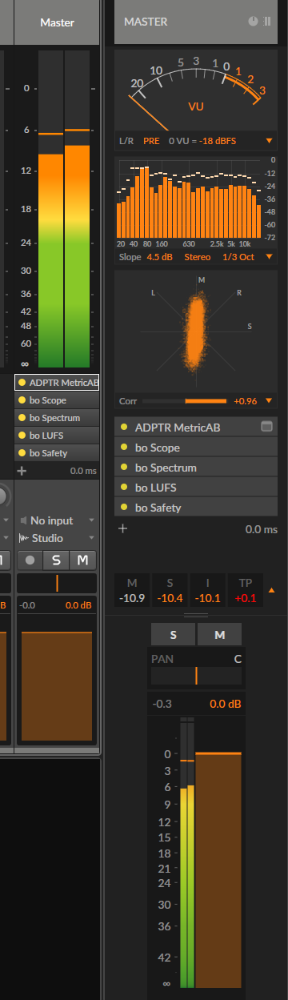
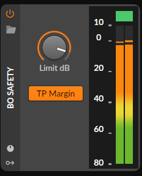
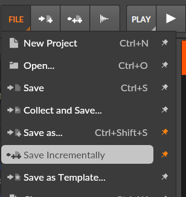
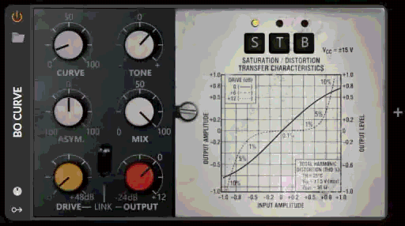
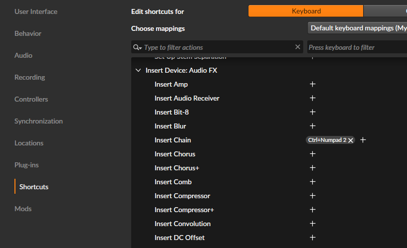
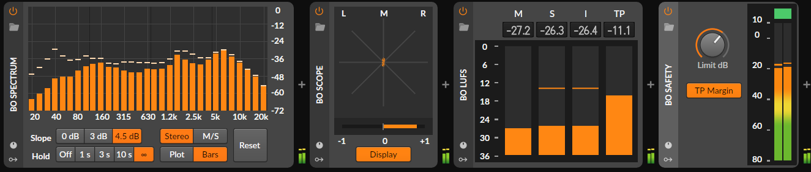

# bo-bitwig

Mods and devices for Bitwig Studio. They run with the Patchbay mod loader (BML) on Bitwig 6.1.4 and 6.1.7 for Windows.

<table>
  <tr>
    <td valign="top"></td>
    <td valign="top">
      
       
      
    </td>
  </tr>
</table>

## Mods

### [bo Master](mods/bo-master)

https://github.com/user-attachments/assets/1be3e125-fb3e-419e-9922-86086e3542f7

The master track's strip pinned on the right side, solo or next to Bitwig's Browser: VU meter, loudness, spectrum, goniometer, fader, pan and the master's plug-ins.
Master is always visible, also in Edit or Arranger view. It supports the Insert FX handling, Track Remotes and display of the dedicated bo Bitwig devices for metering.
The devices have to be download and installed from the links below.

**Download:** [bo-master.zip](https://github.com/bo3k/bo-bitwig/releases/latest/download/bo-master.zip) and [panels-framework.zip](https://github.com/bo3k/bo-bitwig/releases/latest/download/panels-framework.zip) (needed). Its meters come from the devices [bo LUFS](devices/bo-lufs), [bo Spectrum](devices/bo-spectrum) and [bo Scope](devices/bo-scope).

### [Save Incrementally](mods/save-incrementally)

Saves the project as its next numbered version: `Mix_009` becomes `Mix_010`, if the name doesn't end on a digit it will add one.

**Download:** [save-incrementally.zip](https://github.com/bo3k/bo-bitwig/releases/latest/download/save-incrementally.zip)

### [Insert Device via Shortcut](mods/insert-device-via-shortcut)

 Shortcuts" width="520">

A shortcut for every Bitwig effect and instrument. You choose the keys.

**Download:** [insert-device-via-shortcut.zip](https://github.com/bo3k/bo-bitwig/releases/latest/download/insert-device-via-shortcut.zip)

## Devices

| Device | What it does | Download |
|---|---|---|
| [bo Curve](devices/bo-curve) | 1st modding test, a custom saturator with three characteristics. It also has three skins | [bo-Curve.bwdevice](https://github.com/bo3k/bo-bitwig/releases/latest/download/bo-Curve.bwdevice) |
| [bo Safety](devices/bo-safety) | Safety limiter for the master. Protects speakers and ears from sudden loud peaks | [bo-Safety.bwdevice](https://github.com/bo3k/bo-bitwig/releases/latest/download/bo-Safety.bwdevice) |
| [bo LUFS](devices/bo-lufs) | Loudness meter: momentary, short-term, integrated, true peak. Required for bo Master | [bo-LUFS.bwdevice](https://github.com/bo3k/bo-bitwig/releases/latest/download/bo-LUFS.bwdevice) |
| [bo Spectrum](devices/bo-spectrum) | 31-band spectrum. Required for bo Master | [bo-Spectrum.bwdevice](https://github.com/bo3k/bo-bitwig/releases/latest/download/bo-Spectrum.bwdevice) |
| [bo Scope](devices/bo-scope) | Goniometer and correlation meter. Required for bo Master | [bo-Scope.bwdevice](https://github.com/bo3k/bo-bitwig/releases/latest/download/bo-Scope.bwdevice) |

**All five in one:** [bo-devices.zip](https://github.com/bo3k/bo-bitwig/releases/latest/download/bo-devices.zip)

## Install

1. **Patchbay (BML)** 0.36.0-dev.13 or later.
2. **Mods:** on Patchbay's Mods page, click **Add Mod…** (or drop the zips on its window), then tick the mods.
3. **Devices:** put the `.bwdevice` files in a folder and add that folder under **Tools > Device Folders** in Patchbay.

All downloads are also on the [Releases](https://github.com/bo3k/bo-bitwig/releases) page.

---

Building from source: [BUILDING.md](BUILDING.md). The Panels framework is by shaboogen, under the MIT licence.
