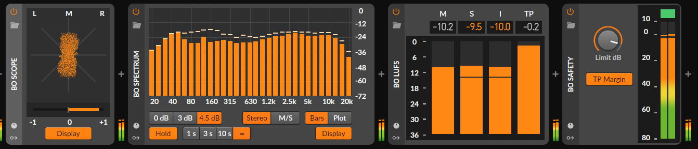

# bo Master

A panel with the master track's strip: VU, LUFS, fader, pan, peak and RMS meters, inserts, spectrum and goniometer. It is a column of its own, left of the browser side, shown and hidden by its button next to the keyboard's in the bottom bar.

bo Master's meter devices on the master track: bo Scope, bo Spectrum and bo LUFS, with bo Safety last in the chain ([`devices/bo-safety`](../devices/bo-safety)).

| Folder | What |
|---|---|
| `mod/` | The bo Master mod (`master-bo`, 0.1.0-dev.71). |
| `panels-framework/` | **Framework: Panels**, Bo's build `0.2.0-dev.2.bo.5`. bo Master needs it (below). |
| `devices/` | **bo LUFS**, **bo Spectrum**, **bo Scope**: the meter devices whose readings bo Master shows. |
| `device-sources/` | Their build scripts and Nitro / SkSL sources. |

## Install

1. In BML, replace the Panels framework with `panels-framework/` (built), and add `mod/` (built).
2. Put the three devices in a folder listed in BML's Device Folders.
3. Insert them on the master or on any track: bo Master finds them by name, on the master first, then on the project's tracks.

## Why its own Panels build

bo Master's view is declared with `side("browser")`, `sideFirst(true)` and `sideColumn(...)`. Those calls exist only in Bo's build of the framework; the original `0.2.0-dev.2` that ships with BML can only place views in the main area and its stacks. What the build adds is in [`panels-framework/CHANGES.md`](panels-framework/CHANGES.md).

## Rebuilding the devices

`device-sources/build_bo_lufs.py`, `build_bo_spectrum.py` and `build_bo_scope.py` need a newer device generator than `tools/device-gen/bwgen.py`: one with trigger buttons, value readouts and Bitwig's scope and spectrum displays. It isn't in the repo yet. The `.bwdevice` files in `devices/` are the current builds.
