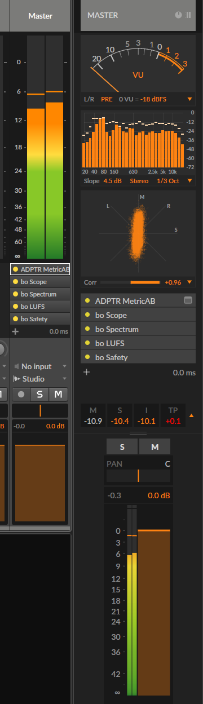

# Panel: bo Master

For Bitwig 6.1.4 (Windows x64). Needs **Framework: Panels** 0.2.0-dev.2.bo.2 or later, Bo's build with views on the browser side (and the framework's own prerequisites, Framework: Settings and Framework: Actions and Menus).

A panel with the master track's strip: a VU meter, fader, pan, peak and RMS meters with peak hold, and the master's inserts with their windows.

## Where it appears

bo Master is a tab of the **browser side**, the right-hand panel with the Browser, Project, Studio I/O and Mappings tabs. Its tab comes first, and its button sits first in that group of the bottom bar, before the Browser's. The side still opens on the Browser by default:

- **Click** it to show bo Master on the browser side; click it again while it is shown to close the side, as Bitwig's own buttons there do.
- **Right-click** it for its scale (75% to 200%), also in **Settings > User Interface > Panel Scale**.
- **Show bo Master** is an action in Bitwig's **Panel Management** category (Settings > Shortcuts, the Commander).
- The side's width is Bitwig's own: drag its edge. In the side's narrow column the strip stacks: VU, header, inserts with the latency under the last one, then a separator and the fader section under it: pan, readouts, fader and meters. Drag the separator up or down to size the fader section (for example to start it level with the device panel's top); the height is kept in bo Master's settings, and a double-click on the separator goes back to the default. Made wider than it is tall, the VU, inserts and pan move to the left of the fader and meters.

It isn't a tab of the lower panels or a view of the Streamlined Views stack. With Panel: Separate Browser Panels (the browser side as columns) it isn't shown.

## The strip

- **VU:** at the top, the master's level on VU needles, with a VU meter's ballistics: a needle reaching 99% of a step in 300 ms, with about 1.3% overshoot. Its deflection is proportional to the level, as on an analogue VU (0 VU at about 71% of the arc, +3 VU at its end, the red zone from 0 to +3).
  - **PRE** (the default) reads the master's input: its device chain's input meter, before the inserts, so the VU shows what arrives at the master. **POST** reads the mixer's meter, after the inserts and the fader (the value Bitwig's controller API gives its VU meter observers). Click **PRE** / **POST** on the strip at the bottom of the VU to switch; the choice is kept. PRE? means the chain's input meter isn't available, and the VU shows POST.
  - Its faces are in Bitwig's theme greys: the darkest grey for the face, the theme's text for the printing and needle, the theme's clipping red for the red zone, and a lighter grey for the strip at the bottom with the channel and the reference. A custom theme follows.
  - Left and right have a face each; where there is room for one face only, both needles share it (left in the text colour, right in Bitwig's orange), labelled L/R.
  - **Click the reference's value** (orange, on the strip) to choose 0 VU: -18 dBFS (the default), -14, -12, -9 or -20 dBFS. -9 dBFS is +4 dBu on an interface where 0 dBFS = +13 dBu. The choice is kept in bo Master's settings.
- **Header:** the master's colour and name. Click it to select the master track, so the device panel shows its chain.
- **Inserts:** the master's devices in chain order.
  - The dot switches a device on (yellow, as on Bitwig's device headers) or off (grey).
  - On a plug-in (of any format), Bitwig's window button (the one on a plug-in's device header) on the right opens or closes the plug-in's window. It is orange while the window is open. Bitwig's own devices have no window, so no button.
  - Click a name to select the master track.
  - When they don't all fit, the last row says how many more there are.
- **Latency:** under the last insert, the master's latency in ms, as the device panel shows it.
- **Pan:** a bar from the centre in Bitwig's orange, with the value (C, L23, R40...).
  - Drag sideways; hold **Shift** for fine steps.
  - **Double-click** or **Alt-click** resets it to the centre.
- **Folding the VU:** a click anywhere else on the VU folds it to a bar labelled VU Meter, in the MASTER header's grey, giving its room to the inserts; a click on the bar opens it again. The state is kept.
- **Fader and meters,** in Bitwig's mixer style and on its scale: labels 0, 6, 12, 18, 24, 36 and ∞ (dB below 0), +6 dB at the top, at the same heights as in Bitwig's mixer.
  - **The fader** is a bar in Bitwig's orange (the theme's accent), darkened, filled up to its level, with a line in the full orange on top. The level in dB is over it, in orange.
  - Drag up or down from anywhere on the bar: it moves with the pointer, without jumping to the click. Hold **Shift** for fine steps.
  - **Double-click** or **Ctrl-click** (Cmd on macOS) resets it to 0 dB. A drag is one undo step, as a controller's touch, move and release.
  - **The meters** are the two thin strips, left and right, in the theme's meter colours (normal, yellow from -9 dB, clipping above 0 dB). The lighter bar is the peak; the solid bar in it is the RMS. The line above is the peak hold: it stays 1.5 s, then falls at 20 dB/s.
  - The light over each meter turns to the clipping colour when that channel has gone above 0 dBFS. The readout over the meters is the highest peak since the last reset.
  - **Click the readout or a clip light** to reset the clips, the hold and the highest peak.

## What is kept

Nothing goes into the project: the panel reads and sets the master track as Bitwig's own controls do. Its place and size are kept by Framework: Panels with the project's view settings, as Bitwig's own panels' are. Peak readings start again when the panel is built again (a new window or project).

## Limits

- The meters and the VU read Bitwig's display-rate peak and RMS values: the VU's ballistics are bo Master's, on top of the RMS Bitwig sends. LUFS loudness needs the audio itself and is planned with a meter device on the master.

## Moving the VU and the LUFS section

Each has a small orange triangle at its right end (the VU: in its bottom strip, or in the folded bar), pointing where a click moves it:
- **VU**: three places: **top** (right under MASTER, above the big meters), **middle** (under the big meters; two triangles, up and down) and **bottom** (right above the fader section, above the LUFS section when that is at the bottom too). Without big meters, top and middle are the same place. 
- **LUFS**: under the VU (triangle down) or right above the fader section (triangle up).

The VU's bottom strip (L/R, PRE/POST, 0 VU = ...) uses a font 2 smaller than the rest.

## Big meters

The three bars at the right end of the MASTER header are Bitwig's **Show Big Meters**: a click shows or hides them (orange while shown, grey while hidden). Where they sit, above or below the VU, is set with the VU's triangles (see above).

The MASTER header stays on top either way. The big meters have their own height (about a third of the panel, at most 320 at 100%). When the separator is dragged up so far that the fader section needs their room, they get shorter (down to 60) and the inserts, the VU and the rest above keep their size and move up with it; only then do the inserts give up rows. They show the peak lighter, the RMS solid and the peak hold as a line, on Bitwig's big-meter scale: +6 dB at the top, 0 to -30 dB in even steps, then -36, -42, -48, -60 and -inf, with marks beside the digits and right of the meters. While they are shown, the fader section has the fader and its scale only (no meters and no peak readout). The state is kept. A click on the big meters resets the peaks.

## Placement

bo Master is a column of its own, to the left of the browser side (between it and the arranger), with its own width (drag its divider; saved with the project). The Browser, Project, Studio I/O and Mappings panels keep their own place, width and buttons; open one and it appears to the right of bo Master.

Its button, a master fader, sits at the right end of the bottom bar, just before the keyboard's: a click shows or hides bo Master. It is shown by default.

Needs Framework: Panels 0.2.0-dev.2.bo.5 (Bo's build).
