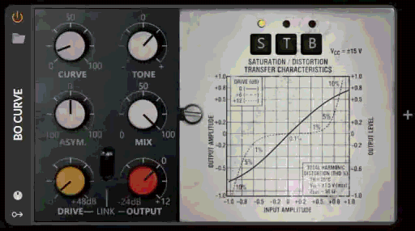
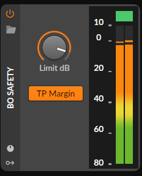
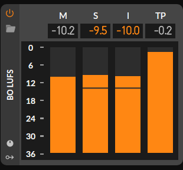
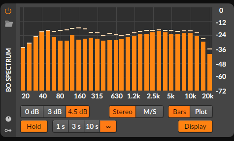
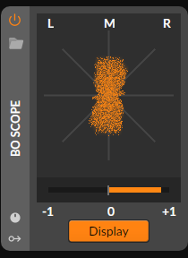

# Devices

Native Bitwig devices. Put the `.bwdevice` files in a folder and add that folder under **Tools > Device Folders** in Patchbay. Their greys follow your Bitwig theme.

| | Device | What it does | Download |
|---|---|---|---|
|  | [bo Curve](bo-curve) | Saturator with three skins | [bo-Curve.bwdevice](https://github.com/bo3k/bo-bitwig/releases/latest/download/bo-Curve.bwdevice) |
|  | [bo Safety](bo-safety) | Protects speakers and ears from sudden loud peaks | [bo-Safety.bwdevice](https://github.com/bo3k/bo-bitwig/releases/latest/download/bo-Safety.bwdevice) |
|  | [bo LUFS](bo-lufs) | Loudness meter | [bo-LUFS.bwdevice](https://github.com/bo3k/bo-bitwig/releases/latest/download/bo-LUFS.bwdevice) |
|  | [bo Spectrum](bo-spectrum) | 31-band spectrum | [bo-Spectrum.bwdevice](https://github.com/bo3k/bo-bitwig/releases/latest/download/bo-Spectrum.bwdevice) |
|  | [bo Scope](bo-scope) | Goniometer and correlation meter | [bo-Scope.bwdevice](https://github.com/bo3k/bo-bitwig/releases/latest/download/bo-Scope.bwdevice) |

**All five in one:** [bo-devices.zip](https://github.com/bo3k/bo-bitwig/releases/latest/download/bo-devices.zip)

bo LUFS, bo Spectrum and bo Scope also feed the meters of the [bo Master](../mods/bo-master) panel.
