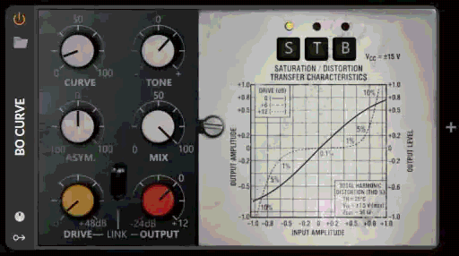

# bo Curve

A saturator, from gentle warmth to hard clipping.

- **Curve:** soft to hard. **Asym:** adds even harmonics. **Drive** and **Output** in dB. **Tone:** saturates the lows more or less than the highs. **Mix:** dry and wet.
- **Link:** on, Output follows Drive, so the level stays about the same while you drive harder.
- **Modes:** Smooth, Triode and Bit.
- **Skins:** Bitwig, Modern and Vintage, in the device's inspector. In Vintage, the screw switches skins too.
- **Oversampling:** Off, 2x or 4x, in the inspector.

**Download:** [bo-Curve.bwdevice](https://github.com/bo3k/bo-bitwig/releases/latest/download/bo-Curve.bwdevice)
