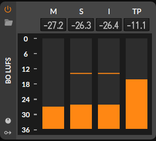

# bo LUFS

A loudness meter after ITU-R BS.1770 and EBU R128. The audio passes untouched.

- **M:** momentary (400 ms). **S:** short-term (3 s). **I:** integrated, since the last reset. **TP:** true peak.
- **Click** a value to reset.

[bo Master](../../mods/bo-master) shows its readings under its VU meter.

**Download:** [bo-LUFS.bwdevice](https://github.com/bo3k/bo-bitwig/releases/latest/download/bo-LUFS.bwdevice)
