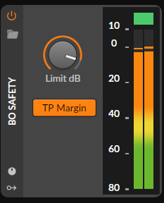

# bo Safety

Protects speakers and ears. The sound passes unchanged until a peak goes over the limit; then the output is muted at once, on that very sample. After 4 seconds of clean signal the volume comes back over 2 seconds. No latency.

- **Limit dB:** -18 to +10 dB, default 0.
- **TP Margin:** trips 1 dB lower, to catch peaks between samples. On by default.
- **Meter:** the output level, with its state: green passing, red muted, orange coming back.

Put it last on the master.

**Download:** [bo-Safety.bwdevice](https://github.com/bo3k/bo-bitwig/releases/latest/download/bo-Safety.bwdevice)
