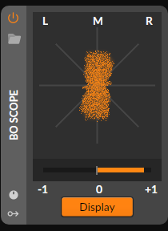

# bo Scope

A goniometer (left and right as a cloud of dots) with a correlation meter under it. The audio passes untouched.

- **Display:** off stops only this panel; bo Master's goniometer goes on.

[bo Master](../../mods/bo-master) shows the same goniometer.

**Download:** [bo-Scope.bwdevice](https://github.com/bo3k/bo-bitwig/releases/latest/download/bo-Scope.bwdevice)
