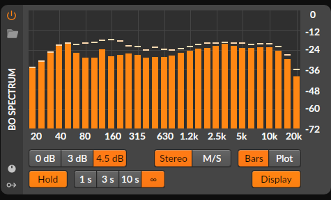

# bo Spectrum

A spectrum in 31 third-octave bands, 20 Hz to 20 kHz. The audio passes untouched.

- **Slope:** 0, 3 or 4.5 dB per octave.
- **Stereo** or **M/S** (mid in orange, side in blue).
- **Plot** or **1/3 Oct.** bars.
- **Hold:** Off, or peak hold for 1, 3 or 10 seconds, or for ever (∞).
- **Reset:** the levels and the peak hold start again.

[bo Master](../../mods/bo-master) shows the same spectrum.

**Download:** [bo-Spectrum.bwdevice](https://github.com/bo3k/bo-bitwig/releases/latest/download/bo-Spectrum.bwdevice)
