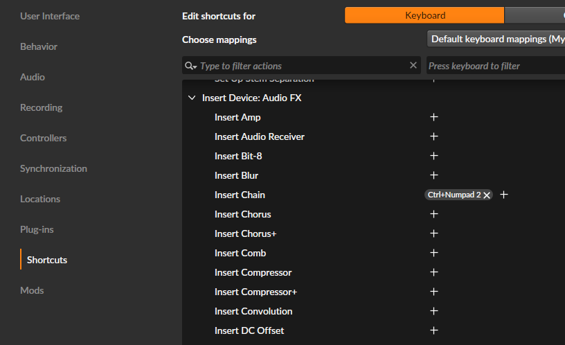

# Commands: Insert Device via Shortcut

Actions that insert a device on the current track (the one whose devices the device panel shows):

- **Insert Tool**, **Insert Chain**, **Insert Pro-Q 4 (VST3)** and **Insert Pro-Q 4 (CLAP)**.
- **Insert [device]** for every other Bitwig audio effect (68) and every Bitwig instrument (44, drum voices included).
- Left out: Note FX, MIDI devices, the legacy MOD devices, and HW CV Out / HW Clock Out.

The device goes after the track's selected device, inside a container when that device is in one. With no device selected, it goes at the end of the track's chain. One undo step.

## Keys

No action has a key of its own, so the mod never conflicts with your shortcuts or anyone else's. You assign the keys you want in **Settings > Shortcuts**:

- **Insert Device: Audio FX**: Tool, Chain, Pro-Q 4 (VST3 and CLAP) and Bitwig's audio effects.
- **Insert Device: Instruments**: Bitwig's instruments.

Type "Insert" in the search to find them. They are in the Commander too.

## Pro-Q 4

- **VST3:** found by its VST3 ID (`ED57BD725C60467EA64DD2F400758B6F`), which is the same on every computer.
- **CLAP:** looked up in Bitwig's CLAP index, as the plug-in whose CLAP ID names FabFilter and Pro-Q 4. The ID it finds is written to the mod log.

Either version has to be installed and scanned by Bitwig. If it isn't, the action does nothing and writes a line to the log.

## Requirements

- Bitwig Studio 6.1.4 (Windows x64).
- Framework: Actions and Menus (`action-menu-composition-framework`) 0.7.0-dev.1 or later.

## Log

Each insert writes one line to the session's mod log (`[insert-device-via-shortcut] ...`).
