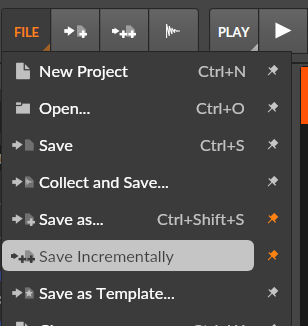

# Project: Save Incrementally

**File > Save Incrementally**, right after Save as. Its icon is Save as with a second plus.

It saves the project as a new file in the same folder:

- If the name ends in a number, the number goes up by one and keeps its digits: `Mix_009` → `Mix_010`, `Mix_3` → `Mix_4`.
- Otherwise `_001` is appended: `Mix` → `Mix_001`.

A name that is already taken is skipped. The project continues under the new file, as with Save As. A project that was never saved opens Bitwig's Save dialog.

It is also an action in the **File** category of Settings > Shortcuts, where you can give it a key.

## Requirements

- Bitwig Studio 6.1.4 (Windows x64).
- Framework: Actions and Menus (`action-menu-composition-framework`) 0.7.0-dev.1 or later.
