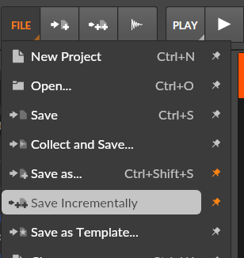

# Workflow mods

| Mod | What |
|---|---|
| [`save-incrementally/`](save-incrementally) | **File > Save Incrementally**, after Save as: saves the project as its next numbered version (`Mix_009` → `Mix_010`, `Mix` → `Mix_001`). |
| [`insert-device-via-shortcut/`](insert-device-via-shortcut) | Actions that insert Tool, Chain, Pro-Q 4 (VST3 or CLAP) and every Bitwig audio effect (68) and instrument (44) on the current track. |

Both need **Framework: Actions and Menus** (`action-menu-composition-framework`) 0.7.0-dev.1 or later, which ships with BML.

No action has a key of its own; assign them in **Settings > Shortcuts**. The actions keep the IDs of BO Tools, the mod they were first in, so keys assigned there still work. Don't tick BO Tools together with these two.
